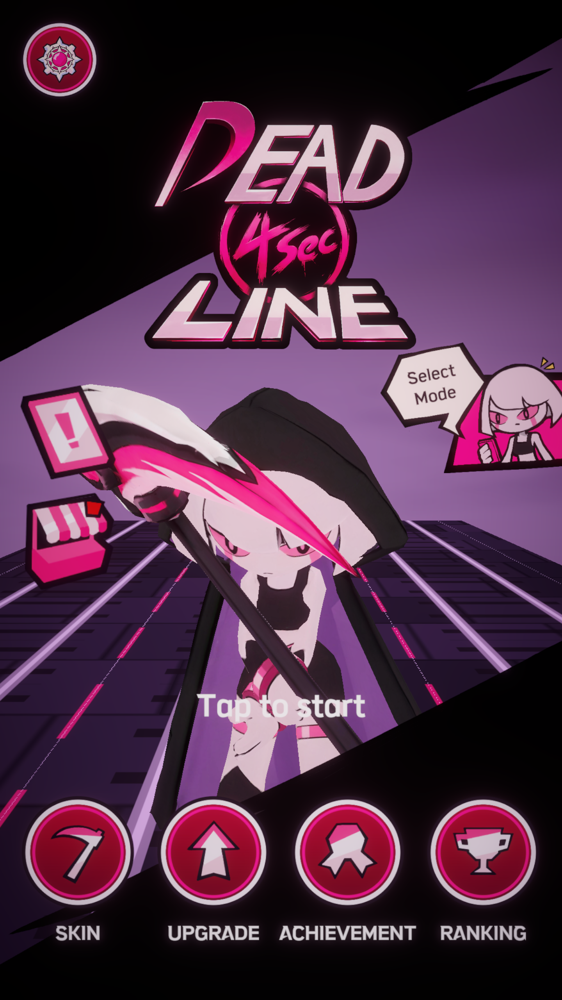
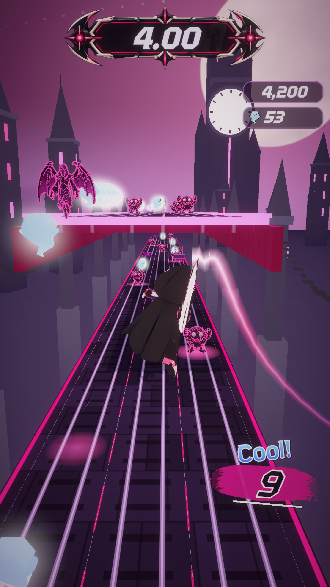
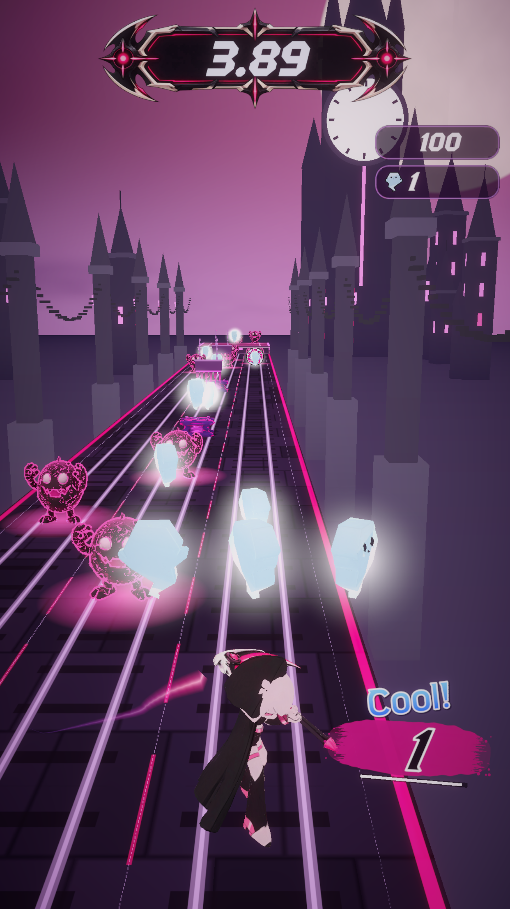

# Deadline:4초 중간고사 게임 기획서

> 기준일: 2026-10-26 · 개발 형태: 1인 개발 · 기준 리비전: `c393916` (2026-10-20)
> 커밋 제목 정리 전 ID는 `06bfd35`다. 파일 내용과 작성 날짜는 같으며 [변경 전후 목록](../development/commit-history.md)에 대응 관계를 기록했다.
>
> 이 문서는 구현 내용과 기말까지의 계획을 구분하며, GitHub에서 관리하는 마크다운 기획서다.

## 1. 한 줄 소개와 컨셉

**적 처치와 아슬아슬한 회피로 생존 시간을 다시 4초로 채우며, 이동 자체를 공격으로 연결하는 모바일 3D 액션 러너.**

- 장르: 싱글 플레이 3D 액션 러너, 무한 진행, 스코어 어택.
- 목표 플랫폼: Android 세로 화면. PC 키보드는 개발·검증용 입력으로 유지한다.
- 플레이 경험: 줄어드는 시간의 압박, 성공 직후의 안도감, 공중 연계를 이어 가는 손맛.
- 시각 방향: 후드를 쓴 안드로이드 사신과 낫, 시계탑, 검정·보라·분홍 중심의 고딕 판타지.
- 대상: 짧은 시간에 반복 도전하고 조작 숙련과 최고 기록 갱신을 즐기는 플레이어를 가정한다.

### 레퍼런스

| 게임 | 참고할 요소 | 이 프로젝트의 적용 방향 |
| --- | --- | --- |
| [Slash & Girl - Endless Run](https://play.google.com/store/apps/details?id=com.slash.girl.redfish&hl=ko) | 질주 중 적을 베는 액션, 타격 피드백, 캐릭터 표현 | 이동과 공격을 연결하고 성공 여부를 즉시 전달한다. |
| [Blades of Brim](https://play.google.com/store/apps/details?id=com.sybogames.brim) | 러닝과 전투의 결합, 콤보, 수집·성장 요소 | 코스에서 연속 행동을 유도하고 결과와 성장 화면을 연결한다. |

위 요소는 공식 스토어 설명을 참고한 설계 해석이다. 차별점은 기본 모드의 **4초 생존 타이머 회복 규칙**이며, 레퍼런스의 캐릭터·그래픽·사운드를 게임 에셋으로 사용하지 않는다.

## 2. 핵심 게임플레이 루프

1. 자동 전진하면서 다음 적·장애물과 남은 시간을 확인한다.
2. 좌우 레인 이동, 점프, 슬라이드 또는 공중 행동을 선택한다.
3. 유효 처치 또는 비접촉 니어 미스에 성공하면 기본 생존 시간을 4.00초로 회복하고 점수·콤보를 얻는다.
4. 더 빨라지고 어려워지는 코스에서 성공을 반복한다.
5. 사망 후 기록을 확인하고 재도전한다.

### 입력과 공격

| 입력 | 지상 | 공중 |
| --- | --- | --- |
| 좌·우 스와이프 | 3레인 이동과 레인 공격 | 레인 변경 |
| 위 스와이프 | 점프 | 유효 공중 적을 향한 호밍 공격 |
| 아래 스와이프 | 슬라이드 | 빠른 낙하. 충분히 높은 상태에서는 그라운드 슬램 |

적 머리 윗면 접촉은 스톰프 처치와 바운스로 연결한다. 슬램의 광역 공격은 맨 바닥에 착지했을 때 발생한다. 장애물 윗면의 안전한 착지는 니어 미스 보상을 주지 않는다.

### 성공·승리·패배 조건

- 무한 러너이므로 고정된 최종 스테이지나 엔딩 승리는 없다. **이전 최고 점수를 갱신하는 것**을 플레이 목표로 삼는다.
- 기본 Deadline 모드에서는 시간 만료, 유효 적·장애물 충돌 또는 코스 낙하로 실패한다. 보호 효과·부활은 별도 예외 규칙을 따른다.
- 처치·니어 미스는 시간을 더하는 방식이 아니라 현재 최대치로 초기화한다. 기본 최대치는 4초다.
- 현재 아이템에는 시간 정지와 일시적 최대 시간 확장이 있다. 벽 달리기 중에도 타이머를 잠시 멈춘다.
- 현재 Classic 모드는 생존 타이머를 끄고 충돌·낙하 중심으로 진행하며, 최고 기록을 모드별로 저장한다.
- 과제의 약 10분 기준은 튜토리얼·일반 런·결과·재시도를 경험하는 **시연 분량 상한**이다. 10분 생존을 강제하는 승리 조건은 추가하지 않는다.

## 3. 현재 개발 내용과 범위 선언

### 현재 확인한 구현

| 영역 | 확인 내용 | 근거와 검증 수준 |
| --- | --- | --- |
| 코어 액션 | 자동 전진, 3레인, 점프·슬라이드, 호밍, 스톰프, 슬램 | `Assets/Script/PlayerController.cs`, `Enemy.cs`, `Obstacle.cs` 코드 확인 |
| 런 규칙 | 4초 타이머, 니어 미스, 점수·콤보, 속도 상승, 결과·기록·재시도 | `GameTimer.cs`, `RunManager.cs`, `GameFlowManager.cs` 코드 확인 |
| 진행·코스 | 난도별 패턴 선택, 상층 코스, 벽 달리기 | `CoursePattern.cs`, `PatternSpawner.cs`, 패턴 프리팹 27개 존재. 전체 조합의 현재 검증 완료를 뜻하지 않음 |
| 화면·성장 | 타이틀·모드 선택·튜토리얼, 코인·파워업·강화·스킨, 업적·일일 퀘스트 | 관련 스크립트와 2026-10-11~16 저장 스크린샷 확인 |
| 기기 실행 | Android 설치·실행·조작 | 개발자 본인 확인(2026-10-26 대화). 기종·FPS·발열 수치는 미기록 |
| 온라인·수익화 | 리더보드 연동 코드, 광고·구매 UI | 리더보드 ID가 비어 있고 에디터 mock 사용. 광고 부활은 로그 처리. 서비스 완료로 보지 않음 |

과거 검증에는 코인·파워업 회귀 **48/48 통과(2026-09-28)**와, 이후 소스 회귀 **51/53 통과(2026-09-29)**가 함께 남아 있다. 후자는 저장·스와이프 테스트 실패 2건을 포함한다. 다른 후속 부분 검증 기록도 있으므로 이를 현 리비전의 전체 실패 또는 전체 통과로 단정하지 않는다. 기말 전 현재 리비전 기준 전체 회귀를 다시 실행한다.

### 기말 MVP: 반드시 완성

- Android에서 시작·튜토리얼·Deadline 런·결과·재시도를 끊김 없이 실행한다.
- 캐릭터 1종, 시각 테마 1종, 기본 패턴 A~E를 최소 보장한다. 기존 추가 코스는 통과 가능한 것만 유지한다.
- 4초 회복 규칙, 핵심 이동·전투, 니어 미스, 점수·콤보와 로컬 최고 기록을 완성한다.
- FSM 전이와 PCG 연결·보상 간격을 재검증하고, 일반/사망/재시도 흐름의 중복 처리를 막는다.
- 짧은 시연에서 튜토리얼·런·결과·재도전을 약 10분 안에 경험한다.
- 실기기 조작 회귀와 10분 연속 구동을 기록한다. 30 FPS 이상을 검증 목표로 설정하며 실측 결과와 구분한다.

### 시간이 되면 완성

현재 있는 Classic, 상층 코스·벽 달리기, 파워업·강화, 스킨·업적·일일 퀘스트의 품질을 높인다. 신규 대형 시스템 추가보다 기존 기능의 안정화를 우선한다. 일정이 부족하면 해당 기능을 시연에서 제외하거나 비활성화한다.

### 이번 기말 범위에서 제외

멀티플레이, 오픈 월드, 스토리 캠페인·보스, 실시간 LLM NPC, 실제 광고·결제 운영, Google Play 온라인 리더보드 출시, 스토어 정식 출시는 포함하지 않는다.

## 4. 생성형 AI 활용 계획

모든 산출물의 채택·수정·최종 검증은 개발자 본인이 맡는다. 아래 직군은 팀원이 아니라 **한 사람이 수행하는 역할**이다.

| 직군 | 지원 AI | 활용 범위와 사람의 책임 |
| --- | --- | --- |
| 기획 | ChatGPT | 규칙·범위·밸런스·기획서 초안을 정리하고 개발자가 실제 플레이와 코드에 맞게 확정한다. |
| 프로그래밍 | Codex, Claude Code(Unity MCP) | C#·FSM·PCG·UI 연결과 오류 분석을 보조한다. 개발자가 변경사항을 검토하고 재현 테스트한다. |
| 2D·3D 아트 | ChatGPT, Codex imagegen 스킬, Tripo | UI·컨셉 시안을 생성하고 직접 리터칭한다. Tripo 모델은 Unity에 맞게 감량·재질·크기·리깅을 확인한다. |
| 사운드 | Suno | 유료 요금제로 BGM 후보를 생성한다. 개발자가 곡을 선택하고 루프·볼륨·경고음 간섭을 확인한다. |
| QA·문서·일정 | Codex, ChatGPT | 테스트 조건·오류 기록·문서 초안을 보조한다. 실기기 실행과 최종 제출, GitHub 기록은 개발자가 수행한다. |

**현재 사용자 확인:** Tripo와 Suno는 생성 당시 유료 요금제를 사용했다. UI·컨셉 이미지는 ChatGPT 또는 Codex의 imagegen 스킬로 시안을 만든 뒤 직접 리터칭했다. 본 기획서의 조사·초안·문서 작성에는 Codex를 활용했다.

### 직군별 프롬프트 계획

| 직군 | 프롬프트 예시 | 채택 기준 |
| --- | --- | --- |
| 기획 | “기본 생존 시간 4초, 이동=공격 규칙의 성공·실패·예외를 전이표로 정리해줘. 현재 코드와 기말 제안을 구분해줘.” | 실제 코드·씬과 불일치하는 규칙을 제거한다. |
| 코드 | “Unity 6000.3.7f1에서 적 머리 접촉은 스톰프를 우선하고 슬램 광역은 맨 바닥 착지만 허용해줘. 재현 조건도 제시해줘.” | 컴파일과 경계 충돌 회귀를 확인한다. |
| 아트 | “검정·보라·분홍의 후드 사신과 낫. 세로 모바일에서 실루엣이 읽히는 UI/저폴리 3D 시안을 만들어줘.” | 직접 리터칭, 모바일 가독성·메시·텍스처·리깅 검수. 수치 예산은 실측 후 결정한다. |
| 사운드 | “보컬 없는 고딕 액션 러너 BGM. 긴장감을 유지하고 반복 재생 경계가 자연스러우며 경고음을 가리지 않게 해줘.” | 루프 끊김·클리핑·효과음 간섭을 청취한다. |
| QA | “시드·FPS·입력 순서·기대값·실제값으로 실패를 재현하고 수정 전후 결과를 비교해줘. 자동 재현과 실기기 결과를 분리해줘.” | 동일 조건의 재현과 실기기 결과를 별도 보관한다. |

### AI 오류 기록 방식

- `docs/design/ai-error-log.md`에 날짜, 도구·모델, 프롬프트, 기대/실제, 재현 시드·입력·기기, 원인, 수정, 재검증, Issue·커밋을 남긴다.
- AI가 작성한 코드도 동일한 검증을 거친다. 출처나 생성 도구를 기록하지 않은 과거 오류를 특정 AI의 오류로 단정하지 않는다.
- 제출 후 범위·수치·규칙을 바꾸면 Issue에 이유와 영향, 변경 전후, 검증 결과를 적고 PR과 연결한다.
- 실제 개발 예시: 튜토리얼 슬램 대상이 착지점에서 멀어 미처치가 발생했다. 판정 반경을 바꾸지 않고 대상 Z를 23.5m에서 21.5m로 조정한 뒤 30/60 FPS 재현을 통과했다. 당시 생성 도구·프롬프트는 미기록으로 남긴다.

## 5. 기술 구성과 저장소

| 항목 | 현재 구성 |
| --- | --- |
| 엔진 | Unity 6000.3.7f1, C# |
| 렌더링 | Universal Render Pipeline 17.3.0 |
| 입력·화면 | Input System 1.18.0, uGUI·TextMeshPro, 세로 모바일 화면 |
| 저장 | PlayerPrefs 기반 로컬 설정·기록·진행도 |
| 개발 보조 | Unity MCP, Tripo Unity Bridge, DOTween |
| 검증 | Unity Test Framework 1.6.0, 기존 AcceptanceTests와 Verification 기록 |
| 저장소 | https://github.com/yusun1115/Deadline-4Sec |
| 현재 브랜치 | `main` |

### 기말까지 적용할 Git 기록 규칙

- `main`: 실행 가능한 기준 버전. 작업은 `codex/<작업명>` 브랜치로 구분한다.
- 커밋 접두어: `feat:`, `fix:`, `docs:`, `test:`. 한 작업의 목적을 설명한다.
- 1인 PR에는 변경 이유·범위·실행 결과·스크린샷을 적고 스스로 검토한 뒤 병합한다. 다인 협업처럼 표현하지 않는다.
- 본 기획은 `docs/design/game-design.md`, 에셋 출처는 `asset-register.md`, AI 오류는 `ai-error-log.md`에 관리한다.
- 씬과 프리팹은 `.meta`와 함께 관리한다. Library·Temp·빌드 산출물은 저장소에서 제외한다.
- Tripo Bridge는 현재 PC의 로컬 경로 의존성이 있다. 제출 README에 설치 방법을 적고, 재현에 필요 없는 개발용 연동은 실행 경로와 분리한다.
- GitHub에는 마크다운 기획서를 관리한다. LMS 제출용 PDF는 별도로 준비해 저장소 링크와 함께 제출한다.

### 에셋 출처와 라이선스

전체 등록부는 [asset-register.md](asset-register.md)를 참고한다. Tripo·Suno의 유료 사용, 직접 리터칭 여부와 외부 패키지·폰트의 출처를 구분한다. 유료라는 이유로 모든 결과물의 권리를 일괄 확정하지 않으며, 해당 결과물 ID·생성/다운로드 이력·약관을 연결한다. 원문이나 도입 기록이 없는 에셋은 추가 확인 후 사용하고, 확인이 어려우면 검증된 대체재로 교체한다.

## 6. 역할 분담

개발자 본인 1인이 기획·C# 구현·씬 조립·2D 리터칭·3D 최적화·BGM 선택·QA·문서·일정과 제출을 맡는다. FSM과 PCG의 책임자도 동일하다. AI는 개발 도구이며 팀원이나 독립적인 최종 승인자로 기재하지 않는다. 직군별 지원 도구와 책임은 4장의 역할 표에 정리했다.

## 7. 8~15주차 일정과 위험 관리

공지의 8~15주차를 작업 단위로 사용한다. 아래는 중간 제출 이후의 **계획**이다.

| 주차 | 개발 목표 | 주요 작업 | 완료기준 | 
| --- | --- | --- | --- |
| 8주차 | 코어 게임플레이 안정화 | 4초 타이머, 적 처치, Near Miss, 점프·슬라이드·호밍·Stomp·Ground Slam 등 핵심 액션 점검 및 버그 수정 | 한 판의 기본 플레이 루프가 중단 없이 동작하고, 사망·부활·결과 화면까지 정상 연결
| 9주차 | 게임 모드 및 기록 시스템 완성 | Deadline / Classic Mode 분리, 모드별 최고 점수·거리 기록, Result 화면 정리 | 두 모드가 동일한 콘텐츠를 공유하면서 각 규칙과 기록이 독립적으로 정상 작동
| 10주차 | 러닝 코스 및 지형 변화 확장 | 기존 3레인 패턴 개선, Air Route·Upper Platform, Wall Run 등 특수 지형 구현 및 PatternSpawner 연동 | 일반 지형과 특수 지형이 자연스럽게 연결되고 다양한 플레이 변화가 체감됨
| 11주차 |성장·보상 시스템 완성 | Soul, Gift Box, Power-Up 강화, Weapon Skin, Consumable, Revive 등 메타 시스템 연결 및 밸런스 조정 | 플레이 → 보상 획득 → 강화·스킨 구매 → 다음 플레이로 이어지는 성장 루프 완성
| 12주차 | 반복 플레이 콘텐츠 구현 | 업적, Daily Quest, Soul Shop, 보상 연출 및 저장 데이터 검증 | 업적·일일퀘스트 진행도가 정상 기록되고, 보상 수령 및 일일 초기화가 정상 동작
| 13주차 | 콘텐츠·연출 완성도 향상 | 게임 BGM·SFX, Hit Stop, Camera Shake, Near Miss·사망·보상 VFX, UI 애니메이션, 게임오버·로딩 화면 개선 | 주요 행동마다 피드백이 명확하고 UI/사운드/연출이 일관된 스타일로 정리
| 14주차 | 모바일 최적화 및 전체 QA	 | Android 실기기 테스트, 터치 입력 보정, UI Safe Area, 프레임·메모리·메시·이펙트 최적화, 저장·재실행 테스트 | 실제 Android 기기에서 약 10분 연속 플레이가 가능하고 치명적 버그 없이 안정적으로 동작
| 15주차 | 기능 동결 및 최종 빌드 | 난이도·보상 최종 밸런싱, 불필요 기능 제거, 버그 회귀 테스트, 빌드·시연 버전 확정 | 기획서에 선언한 MVP가 모두 동작하는 최종 Android 빌드 완성

| 위험 | 대응 | 플랜 B |
| --- | --- | --- |
| 1인 개발 일정 초과 | 코어 규칙과 튜토리얼·재시도 우선, 14주차 기능 동결 | 특수 코스·메타 기능을 시연에서 제외하고 A~E 중심으로 축소 |
| 4초 안에 성공할 수 없는 코스 | 후보 간격과 실제 경로를 따로 검증, 시드 기록 | 실패 프리팹 비활성화, 검증된 고정 순서 코스로 시연 |
| 모델·이펙트로 실기기 성능 저하 | 메시·텍스처·파티클 비용과 기기 성능 측정 | 저폴리/간소화 이펙트, 그림자·포스트 효과 축소, 30 FPS 목표 |
| AI 코드 오류·입력/상태 충돌 | 작은 변경 단위 검토, 컴파일·경계 회귀, 오류 로그 | 최근 정상 버전으로 복귀 후 필수 기능만 재적용 |
| 외부 에셋 권리·도입 이력 부족 | 결과물 ID·구매/생성 이력·약관 수집 | 확인된 에셋으로 교체, 불명확한 리소스 제외 |
| 온라인 SDK·로컬 경로 의존성 | 오프라인 코어와 개발용 연동 분리 | 온라인 기능 제외, 로컬 최고 기록과 검증된 APK로 제출 |

## 부록 A. 프로토타입 증빙

아래는 저장소에 이미 존재하는 Unity 실행 캡처다. 새 실기기 캡처로 오해하지 않도록 촬영 출처를 구분한다.

가산점 제출용으로 현재 스크린샷을 사용한다. 추가 30초 영상은 아직 제작하지 않았다. 촬영할 경우 타이틀·시작 5초, 이동·처치·타이머 회복 15초, 실패·결과·재시도 10초 순서로 구성한다.

## 부록 B. 근거

- 엔진·패키지: `ProjectSettings/ProjectVersion.txt`, `Packages/manifest.json`.
- 핵심 규칙과 수치: `Assets/Script/GameTimer.cs`, `RunManager.cs`, `PlayerController.cs`, `Enemy.cs`, `Obstacle.cs`, `Assets/Scenes/EndlessRun.unity`.
- FSM: `Assets/Script/GameFlowManager.cs`. PCG: `CoursePattern.cs`, `PatternSpawner.cs`와 `Assets/Prefab/Pattern/`.
- 모드·성장: `GameMode.cs`, `PowerUpManager.cs`, `RunInventory.cs`, `GameExtrasUI.cs`, `Assets/Script/Achievements/`, `DailyQuest/`.
- 서비스 미완료: `Assets/Resources/GooglePlay/GooglePlaySettings.asset`, `GameFlowManager.ClickRewardedAd()`.
- 과거 검증: `Verification/README.md`, `coin-powerup-regression-results.xml`, `game-extras-source-regression-results.xml`, `tutorial-replay-30fps.txt`, `android-build.json`.
- 실기기·AI 사용: 2026-10-26 개발자 답변. 설치·실행·조작 확인, Tripo/Suno 유료, UI·컨셉 시안 생성 후 직접 리터칭.
- 웹 출처 확인일: 2026-10-26. 각 레퍼런스 및 라이선스 원문은 본문과 에셋 등록부에 링크한다.
